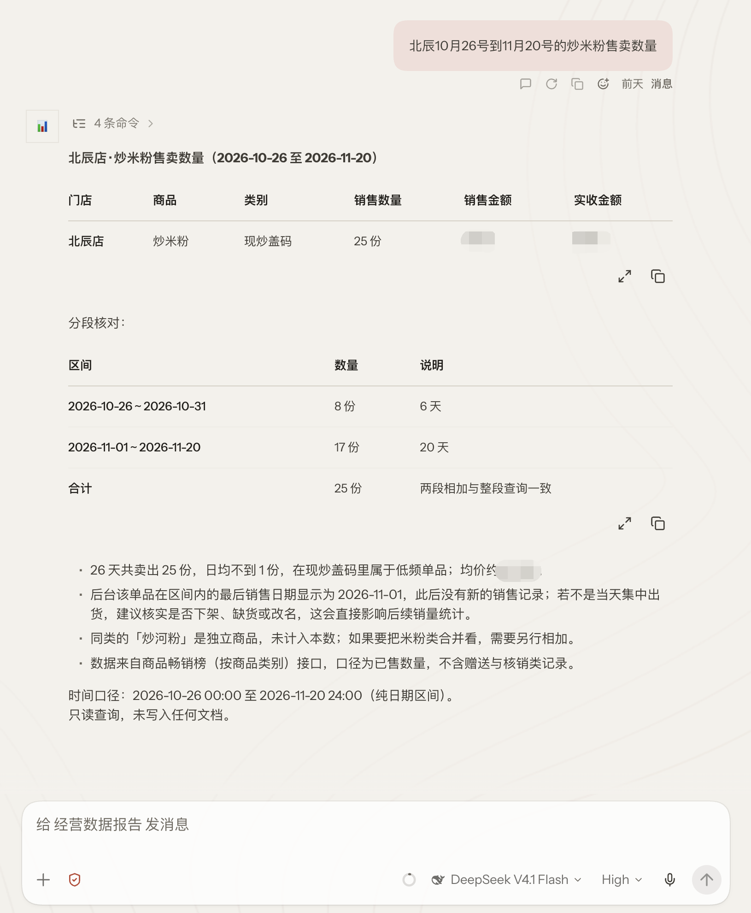
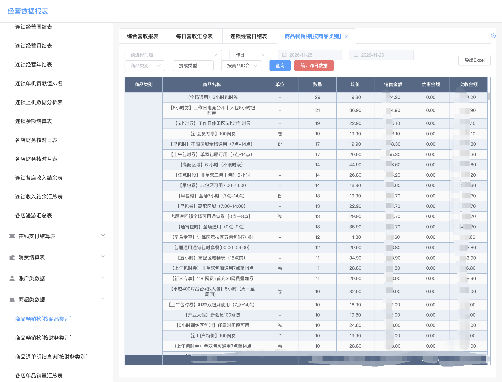

---
tags:
  - think
  - AI
date: 2026-11-26
---

# 一次 FDE 实践，预见架构升级 B/S -> A/S

[上一篇文章](/posts/2026/11/23/fde-ui-revolution/)提到 UI（人机交互）革命，本文继续聊 UI 革命带来的系统架构升级。

## 什么是 A/S 架构

C/S（Client/Server）-> B/S（Browser/Server）-> A/S（Agent/Server），三种架构的本质区别在于用户入口：客户端、浏览器、Agent。

- C/S：需安装专用客户端，体验好、能力强，但分发与更新成本高
- B/S：浏览器即入口，免安装、易分发，但用户仍要在页面与多层级导航中寻找功能
- A/S：Agent 即入口，用户用自然语言表达意图，由 Agent 调用服务完成任务

架构变更的驱动力始终是便捷性：让用户以更低的成本、更短的路径达成目标。

B/S 系统典型特征是迷宫般的导航（顶部、侧边、多层级）、复杂表单页面；  
而 A/S 系统的便捷性、易用性将对 B/S 系统形成降维打击；  
从以下图片可以窥见两套系统完全不同的交互逻辑：

Agent 助理 vs 传统后台系统  



那 UI 革命会给系统架构和程序本身带来什么改变？  
接下来从宏观系统架构、微观程序组织两个维度，聊聊架构升级过程产生的变化。

## A/S 宏观系统架构

A/S 极简架构：

```text
用户
 │
 │  自然语言 / 意图
 │
 ▼
Agent ⇄ Agent (Agent 相互交流)
 │
 │  原子接口 / 接口规格
 │
 ▼
Server（保留核心，薄接口层）
```

用户不再与浏览器、APP 中的前端模块进行交互，而是通过 Agent 对接服务；  
Agent 会分为两种：服务商提供的、可直接使用的**客服型**，以及用户终端本地的**私人助理型**。  
Agent 与 Agent 对接完成任务也是完全有可能的。

原系统 Server 端的核心仍会被保留，因为高并发、大数据的处理需求不仅不会减弱，反而会增强；  
原系统的 Server 端需做部分重构，以适配 A/S 架构，提供原子化的接口与接口规格；

如果剥离掉系统在新架构中不需要的前端 UI 模块，以及与前端相关的接口，那系统还剩下什么？  
应该只剩下**数据库**核心，和一层非常薄的原子接口，甚至原子接口也非必需，可以让 Agent 在受控前提下直接操作数据库。

所以，新项目将从“数据库 - Agent”的最简化结构中生长出来。

总结来说，Agent 替代原架构中的前端模块（去 UI 化），Server 系统做部分重构以适配新架构。

## A/S 微观程序组织

由于 A/S 新架构的去 UI 化特征，Server 端倾向于简化，保留原子接口、扩展接口的规格描述，相对来说，程序组织形态的变化也主要体现在前端。

大语言模型只能回答问题，配合通用 Agent 就能在计算机上完成许多日常任务；  
完成垂直领域、具体场景中的工作，则需要教会 Agent 特定的 Skills（技能）。

Skill 包含专用上下文信息、专用工具、专用视图组件：

- 专用上下文信息基本采用 Markdown 文档维护；
  - 专有名词、主体、主体之间的关系，当前已经形成共识 —— 使用 Markdown 文本描述
- 专用工具则是将确定性的、可自动化的任务使用脚本（通常是 TS、Python）实现，在 **性能与成本（时间、token）** 之间取得平衡
  - 完成某个任务，需要批量或顺序调用 N 个接口、进行数学计算时，最好用脚本实现
- 传统 UI 页面会被对话框替代，专用的视图组件则会被保留下来，用以平衡**复杂信息与可读性、可交互性**之间的矛盾
  - 复杂多维数据必然要用可视化图表来展现，剪辑素材与时间的关系最好用轨道视图来表达；
  - 这些专用视图组件可作为人机语言沟通的辅助工具

FDE 的工作就是：为 Agent 整理、分类专用的上下文信息，开发、维护专用的工具、视图组件；  
简而言之 —— 给通用 Agent 做配套，打造专用 Agent 来服务客户。

## 总结

A/S 架构之所以会替代当前主流的 B/S 架构，原因是：

- 填补小规模系统的缺失
  - A/S 架构，一个数据库 + Agent 即可提供相对基础的功能，小规模场景往往是系统尚未覆盖的领域
- 降低中等规模系统的开发与学习成本
  - A/S 架构，以权限、商品状态等基础数据库为核心，无需开发前端页面，开发维护成本极低
- 改进大规模系统的用户体验
  - A/S 架构，让用户在手机端随时访问，学习成本极低，无需配专人对接复杂系统
