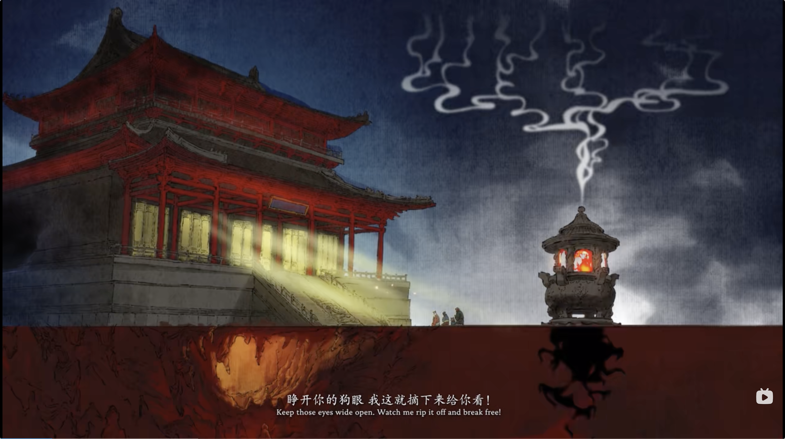

# 主题：斗争

## 毛选

- 为什么吸引我
  - 马督工解读采茶女工现象，引用《湖南农民运动考察报告》
  - 段落：中国的男子，普通要受三种有系统的权力的支配，即：（一）由一国、一省、一县以至一乡的国家系统（政权）；（二）由宗祠、支祠以至家长的家族系统（族权）；（三）由阎罗天子、城隍庙王以至土地菩萨的阴间系统以及由玉皇上帝以至各种神怪的神仙系统——总称之为鬼神系统（神权）。
    **至于女子**，除受上述三种权力的支配以外，还受男子的支配（夫权）。这四种权力——政权、族权、神权、夫权，代表了全部封建宗法的思想和制度，是束缚中国人民特别是农民的四条极大的绳索···夫权这种东西，自来在贫农中就比较地弱一点，因为经济上贫农妇女不能不较富有阶级的女子多参加劳动，所以她们取得对于家事的发言权以至决定权的是比较多些···
- 最近的史诗
  - 可歌可泣的近代史：反封建军阀（统一战线），内战，抗战（统一战线），内战
- 主要内容
  - 政论、宣传：跟蒋校长对喷很有意思
  - 战略规划、战争动员与指导：神预言
    - 论持久战
  - 哲学、社科，最有深度
    - 矛盾论
      - 矛盾是内在的，会动态变化，无法完全消除
      - 多个矛盾时，要抓住主要矛盾
    - 实践论：
      - 知行合一，在实践过程中迭代自己：实践 -> 认识 -> 再实践 -> 再认识
      - 对事物的认识：感性认识（体验、情绪） -> 理性认识（背后的原因、规则）
    - 辩证唯物观
      - 全面、发展、联系地看待问题
      - 结合矛盾论与实践论，认识矛盾、解决矛盾
- 论共产党员的修养
  - 人们为了要生活，就必须和自然界进行**斗争**，利用自然界来生产物质资料。人们的物质生产，在任何时候、任何条件下，都是社会的生产。
    所以，人们在社会发展的任何阶段进行生产的时候，都要建立一定的生产关系。人类在和自然界的不断斗争中，不断地改造自然界，同时也不断地改造着人类自己，改造着人们彼此间的关系。
    人们的本身，人们的社会关系、社会组织形式以及人们的思想意识等，都是在社会的人们和自然界的长年斗争中不断地改造和进步的。
    在古代，人们的生活样式、社会组织、思想意识等，和现代人们的都不同；而在将来，人们的生活样式、社会组织、思想意识等，又会和现代人们的不同。

## 黑神话

- 为什么吸引我
  - 音乐、故事、美术
  - 游戏性一般，艺术性一流
- 故事内容
  - 西游记
    - 明线：主角团历经八十一难，修得正果 —— 个人修行
    - 暗线：仙佛两派的对抗与合作 —— 党争
    - 斗争、渡人不是主题
  - 黑神话
    - 背景：猴子的斗争精神与三界秩序不兼容，重上井冈山
      - 拜师傅、修正果 -> 丢掉幻想，准备斗争
    - 斗罢艰险，收集根器，两个结局：
      - 五根器：带上金箍，接受秩序 —— 个人修行
      - 六根器：打破锁链，解放世界 —— 革命斗争
- 《未竟》音乐、动画
  - 
    - 霞光瑞霭建立在恐怖统治之上
    - 不是终点，是新的斗争起点
  - 动画倒放八十一难取经路：找回初心
- 《未竟》歌词
  取了真经 真假如幻
  封了神佛 神思难安
  成了大道 大地凋零依然
  得了千秋功名 千千万生灵涂炭
  ···
  肉化成土 埋葬背叛
  骨烧成灰 涂抹苦难
  血兑成水 淹没所有呐喊
  精魂炼成了丹 从此尝不出辛酸
  ···
  英雄被写成诗 只剩爱与勇敢
  诗凝成画 不容悲欢
  你我原是 有情有欲人
  天地不平心不甘

- 《贺新郎·读史》
  - 五帝三皇神圣事，骗了无涯过客。有多少风流人物。盗跖庄蹻流誉后，更陈王奋起挥黄钺。歌未竟，东方白。

## 强行对号入座

- 强行对号入座，不一定完全正确，但肯定很有意思
- 西游记
  - 西方如来
    - 那南赡部洲者，贪淫乐祸，多杀多争，正所谓口舌凶场，是非恶海。
      寻一个善信，教他苦历千山，询经万水，到我处求取真经，永传东土。
    - 实际：灵山在西牛贺洲，离狮驼岭不远
  - 西方列强：东亚病夫，愚昧无知，找个代理人，赐予他们文明火种
    - 实际：日不落帝国，资本家“以压抑平民为本份”
  - 东土的“善信” —— 蒋校长、汪精卫
    - 扫除（无后台）妖魔（势力），修得正果佛位
- 黑神话
  - 孙悟空 —— 孙中山
    - 提出：联俄联共，节制资本，三民主义
  - 妖魔鬼怪（蒋校长、汪精卫、孙科等）分了大圣根器
    - 有人供起来不敢用，有人用来妖言惑众，有人不敢反抗身不由己
  - 天命人 —— 革命先烈
    - 斗罢艰险，收集根器（继承孙中山三民主义），打破金箍（锁链）

## 斗争的精神图腾

- 未竟：他们被说成书，区区八十一难，书刻成碑，光明灿烂，试问有谁，再打破顽空，不堕轮回万古传
  - 鸿蒙初辟原无姓，打破顽空须悟空
- 教员：今日欢呼孙大圣，只缘妖雾又重来
